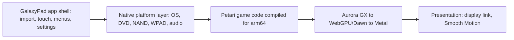

# Native engine plan

**Start here for the next major direction.** Status as of 11 October 2026.
This plan proposes replacing GalaxyPad's game backend (PowerPC code translated
ahead of time, running on a Dolphin-derived runtime) with the game compiled
natively from the Petari decompilation. It also sets out how to build 120 FPS
presentation, lower input latency and a mod layer on top. Nothing here has
shipped. The current app, its maintained forks and private build 7202 are unchanged.

## Overnight 11-12 October: native build plays on iPhone 14 and iPad Pro

A separate test app, `org.galaxypad.native-probe` (Galaxy Native), now launches
from the Home Screen on both devices and plays with touch controls. GalaxyPad,
its forks, its saves and build 7202 were not touched. Changes are on the local
MacioGalaxy branch `galaxypad/ios-native` in the private workspace (not pushed).

**iPhone 14, iOS 26.6.2, go/no-go (Phase 1 gate): passed.** Restored Comet
Observatory, 120-star save, warm shaders, 10 minutes: 35,949 gameplay frames, one
over 20 ms (in the first two minutes), p99 17.04-17.11 ms in every two-minute
segment, game logic about 2 ms a frame, thermal state serious from minute 3 to 10.
Build 7202 on the same phone: 33-38 FPS and about 0.6x game speed in that area.

With every shader prepared, the Observatory route on the iPhone leaves real
headroom (median idle per 16.7 ms frame): Observatory 7.2 ms, Terrace 11.5 ms,
Good Egg 9.1 ms. Lower render scales did not help; resolution is not the limit.

| Item | Result |
| --- | --- |
| Touch controls | Floating stick, A/B/X (Spin)/Y (C)/Z, +/-, 1/2, Home; the Star Pointer follows the finger exactly, with no IR calibration. On phones the buttons and pills stand in the pillarbox bars, clear of the HUD and the notch. The whole gameplay script passed through synthetic touches on both devices, with the same movement distances as the keyboard. Real-finger feel is untested. |
| Saves | A touch-created save reloaded in a new process on the iPhone; loading left the save hash unchanged. |
| Audio | 92 one-second reports on the iPhone, 0 underruns. Not judged by ear. |
| Shaders | One-time preparation on the first launch (progress screen, tap to skip): 166 s cold on iPhone 14, 148 s on iPad Pro, 38 s with a warm system cache. It fills the system Metal cache, so later launches start at once. Without it, background compiles kept iPhone draw waits near 14 ms for minutes. |
| Aspect | New users get the game's own 4:3 mode on 4:3 screens (iPad, full screen) and 16:9 on phones. |
| Rides | Star Ball and Ray mechanic checks give the same results by touch and keyboard; both fail the same way upstream (tilt-back threshold; Ray approach route), so rides need a human run. |
| Movies | Not needed on these routes; installed on the iPhone (all) and the iPad (prologue only, for storage). |
| Input latency | MacioGalaxy's probe, iPad Pro, 50 automated A presses in Good Egg: 47.1 ms press-to-present median in the Wii frame order (the response is shown two frames after the read). Running update and animation before drawing in the same frame (`PETARI_LOW_LATENCY`, now the iOS default) gives 28.6 ms (one frame); the gameplay checks pass with identical movement values. |
| Save migration | GalaxyPad's save is the Wii big-endian form of the same layout. `wii_save_to_native.py` converts it, with field widths from the game's serializers. The iPhone's 121-star GalaxyPad save passes MacioGalaxy's native checker with identical values and loads into the restored Observatory on the Mac, the iPad and the iPhone (121 stars, 2,324 Star Bits, Luigi); it is installed in both test apps' normal save folders. |
| Stage sweep | All 47 stages, scenario 1, through the touch layer on the iPhone: 45 pass. EpilogueDemoStage is a cutscene with no player. In FishTunnelGalaxy Mario dies in the scripted idle after the checks; it passes on the Mac and on the iPad at 16:9 and fails on the iPad at 4:3, so the camera and aspect change the scripted route. Worst two-minute gameplay p99 20.9 ms (OceanPhantomCave); largest single frame 33 ms. |

120 FPS was scoped but not built. BlueWake's Smooth Motion lives in RecompCore's
Aurora fork and is keyed to RecompCore's draw plans. Petari's frame loop draws
state computed in `calcAnim` (`calcViewAndEntry` bakes the camera into J3D draw
matrices), so model-keyed matrix interpolation is clean in principle, but a
second presented frame per game step has to be made below the Wii XFB and
retrace framework, at the Aurora command level. Next step: port the blend core
onto upstream Aurora's per-draw uniforms, re-encode the finished frame, and
measure on the ProMotion iPad.


## Why now

On 28 September the Super Mario Galaxy decompilation
([Petari](https://github.com/SMGCommunity/Petari), CC0) reached 100% matching
code. By 11 October its USA `RMGE01` configuration was in place and 68.75% of
code was fully linked. Several native ports appeared within two weeks:

| Project | Platform | State on 11 October | Relevance |
| --- | --- | --- | --- |
| [MacioGalaxy](https://github.com/classicrob/MacioGalaxy) (CC0) | Apple silicon macOS, Metal through [Aurora](https://github.com/encounter/aurora) (MIT) | Playable; large native test suite; later stages not fully verified upstream | Closest base: same platform family, same disc, same renderer path |
| [GalaxyQuest](https://github.com/bigmak94/GalaxyQuest) (Unlicense) | Meta Quest 2/3, Android arm64, GLES | Reports all 44 galaxies loading and playing, 60 FPS, game thread about 4 ms a frame in Good Egg | Evidence that a mobile chip has headroom; display-list cache technique |
| AstroCore (Luma's Workshop) | PC | Announced, no source or date | Watch; keep the backend swappable |

[Dusklight](https://github.com/TwilitRealm/dusklight), a Twilight Princess port
on the same Aurora layer, ships an iOS IPA every release. It also implements the
two features we want most: frame interpolation with a separate game clock, and a
mod SDK.

The September 26 profile showed the iPhone 14's game thread saturated: about half
in translated code and 30% in chunk switching. A native build removes both.

## Measured so far (Phases 0 and 1a)

Build: MacioGalaxy `4bbf2af23d69`, Release, arm64, Apple clang 21, Aurora
`08122911`. Disc: the exact GalaxyPad input (`RMGE01` rev 0, image SHA-256
`bd0d3d4b…`, `main.dol` `2c680585…`). Machine: M3 Max, macOS 26.6.2.
Workspace: `~/.codex/worktrees/galaxypad-native-research` (private; holds the
extracted disc, saves and logs, never committed). One local change was needed:
`petari_audio_sdl` must link CoreAudio (`native/gx/CMakeLists.txt`).

All smoke scripts drive the game through the normal input layer:

| Run | Result |
| --- | --- |
| `gameplay`: new file, prologue, garden | PASS: idle, jump 203.5 units, opposite moves, pause freezes movement, resume |
| `galaxy`: Observatory, Terrace, Good Egg mission 1 | PASS: same checks inside Good Egg |
| `observe`: 120-star save, restored Observatory, 5,000 frames | PASS |
| 120-star save made through the game's own save code | VERIFIED |

Game thread per frame, gameplay frames only:

| Scene | Game logic, median / p99 | Waiting on the GX front end, median | Interval |
| --- | --- | --- | --- |
| Peach's Castle Garden | 0.42 / 1.04 ms | small | 16.68 ms |
| Early Observatory | 0.95 / 1.39 ms | 4.06 ms | 16.68 ms |
| Good Egg Galaxy | 0.85 / 2.67 ms | 2.76 ms | 16.68 ms |
| Restored Observatory (steady) | 1.57 ms median | 4.88 ms | 16.75 ms median |

Game logic is now close to free. The remaining cost is turning GX commands into
Metal draws, the cost GalaxyQuest cut from 6–8 ms to 4 ms with a display-list
cache. The Mac restored-Observatory run had stutter while another project's
compile held the load average near 107; the iPad run below has none in the same
scene, so treat the Mac spikes as machine load.

### iPad Pro (M2), iPadOS 27.0.1

The same port, built for iOS arm64 (minimum iOS 16), signed with the team
wildcard development profile as a separate test app,
`org.galaxypad.native-probe`, and installed beside GalaxyPad without touching
it. Data: the extracted disc without `MovieData` (955 MB; movies are not played
on these routes) and without `sys/fst.bin`, so the file table is built from
`files/`. Shader cache warm from a first run.

| Scene (gameplay frames) | Frame p50 / p99 / max | Over 20 ms | Game logic p50 | GX front end p50 | Idle p50 |
| --- | --- | --- | --- | --- | --- |
| Early Observatory (895) | 16.68 / 17.43 ms | 0 | 0.80 ms | 5.84 ms | 9.82 ms |
| Terrace dome (2,173) | 16.71 / 17.29 ms | 0 | 0.31 ms | 2.68 ms | 13.57 ms |
| Good Egg Galaxy (1,832) | 16.69 / 17.29 ms | 0 | 0.44 ms | 3.99 ms | 12.11 ms |
| Restored Observatory, 120-star save (3,152 after warm-up) | 16.69 / 17.44 / 17.7 ms | 0 | 0.92 ms | 6.59 ms | 8.95 ms |

The `galaxy` smoke script passed on the iPad, and Mario's positions after the
scripted moves matched the Mac run to six decimal places. In the restored
Observatory, GalaxyPad's heaviest measured scene, the game thread is idle for
more than half of every frame. No matched GalaxyPad run on this iPad was taken
the same day.

The first, cold run showed the main iOS tuning item: with no CPU count from
`sysctl`, the pipeline layer chose blocking mode with one compile worker, about
9,500 seeded pipelines queued for up to 115 s, and the Observatory waited
11–12 ms a frame on pipeline resolves until the cache was warm. Each new stage
also paid about 1.5 s of shader preparation at load. Shipping a transferable
pipeline cache for Metal on iOS and sizing compile workers correctly removes both.

The iPhone 14 was not connected, so its numbers are still missing. Its A15 uses
the same CPU core design as the M2 at a lower clock, with fewer performance
cores and a tighter thermal limit.

### iOS build recipe

```sh
cmake -S . -B build/ios2 -DCMAKE_SYSTEM_NAME=iOS -DCMAKE_OSX_ARCHITECTURES=arm64 \
  -DCMAKE_OSX_DEPLOYMENT_TARGET=16.0 -DCMAKE_BUILD_TYPE=Release -DPETARI_BUILD_GX_PROBE=ON \
  -DBUILD_TESTING=OFF -DCMAKE_DISABLE_FIND_PACKAGE_PkgConfig=ON -DCMAKE_DISABLE_FIND_PACKAGE_Freetype=ON
cmake --build build/ios2 --target petari
```

Disabling host package discovery stops Homebrew FreeType and libpng leaking into
the iOS link; Aurora then fetches its own FreeType. Aurora already starts SDL
inside `UIApplicationMain`, and Dawn ships an `ios-arm64` package for the pinned
version. MacioGalaxy needed small local changes in seven files (a 189-line
patch, SHA-256 `eb3dc7733294c537…`, kept in the private workspace as
`macio-ios-local.patch`): link CoreAudio on macOS only,
guard the macOS CoreAudio latency query and `libproc` telemetry, replace
`system("mkdir -p")` with `std::filesystem` in three debug paths, and accept
`~/` (the app container) in `--disc`, `--user` and `PETARI_FRAME_CSV`. The
packaging step rewrites `Info.plist` for iOS (device family, landscape, Game
Mode, full screen) and signs with the wildcard profile.

On device, an app that leaves the foreground is suspended and its smoke
watchdog then reports a stall; keep the test app in front during runs. The
iPad had about 2.5 GB free for the test app, too little for the full 3.2 GB
extraction; plan device storage before copying data.

## Target experience

- **iPhone 14 and other 60 Hz screens:** a locked 60 FPS in the restored
  Observatory on a hot phone, with no audio chopping.
- **ProMotion devices** (iPad Pro, Pro iPhones, ProMotion Macs): 120 FPS
  presentation with the game still running at its original 60 steps a second.
- **Responsiveness:** the Star Pointer exactly under the finger, input read as late
  as possible, presentation tied to the display. Target: one display refresh less
  input-to-photon latency than build 7202, measured.
- **Mods:** opt-in toggles first, a scripting SDK later.

## Architecture



- **Game:** Petari source with the native portability guards
  (`PETARI_NATIVE`, about 900 sites in 366 files) as maintained by MacioGalaxy.
  Game logic stays unmodified except for guarded hooks.
- **Platform and renderer:** MacioGalaxy's `native/` layer and its pinned Aurora,
  carried in a new maintained fork pinned by GalaxyPad (the same ownership rule
  as ModernGekko/RecompCore/DolRecomp). Memory uses ordinary host allocations
  with address translation, which suits iOS; GalaxyQuest's fixed mapping below
  4 GB does not.
- **App:** GalaxyPad keeps its importer, touch layouts, controller handling and
  menus. The current backend stays available behind a build switch until the
  native one passes every gate below.
- **Swappability:** keep the backend interface narrow (frame, input, audio, files,
  saves) so AstroCore or upstream changes can be adopted cheaply.

## Phases and gates

Each phase ends with evidence recorded on device, OS, build and scene, in the
style of the September 26 handoff.

### Phase 0: Mac proof (done)
Build, smoke tests and Mac timing above.

### Phase 1: iOS bring-up
Done on iPad Pro and iPhone 14: iOS build, signed test app, automated routes,
touch controls, save reload, audio counters, first-launch shader preparation and
Home Screen launch. Remaining: real-finger play, audio by ear, and data from
GalaxyPad's importer.

**Gate passed (12 October):** 10 minutes in the restored Observatory on a hot
iPhone 14 held 60 FPS (see the overnight section above).

### Phase 2: mobile frame budget
First-launch preparation is in place (166 s on a cold iPhone 14). Remaining: the
1.5 s stage-start shader gate on each launch (pipelines are recreated from the
system cache; a Dawn pipeline blob cache would remove it), then the display-list
cache and draw batching GalaxyQuest measured, which matter for the 120 FPS budget.

**Gate:** hot iPhone 14, restored Observatory, 10 minutes: p99 interval at most
18 ms, no audio underruns.

### Phase 3: GalaxyPad integration
Native backend inside the GalaxyPad app; settings, Game Mode metadata and
diagnostics carried over. Save migration from the current Wii-format NAND to the
native save format, through the game's own load and save code, with a byte-exact
backup kept and verified (MacioGalaxy's saves are not byte-compatible with Wii
saves). Pull Stars, Star Ball, Ray surfing and pointer targets verified.

**Gate:** stage sweep and dome tour across all galaxies; owner playtest on both
devices; existing saves migrate with backups intact.

### Phase 4: Smooth Motion at 120 FPS
Galaxy's logic advances once per 60 Hz retrace. Running it faster speeds the game
up, so the game keeps 60 steps and the renderer draws in-between frames, as in
BlueWake's Smooth Motion and Dusklight's `dusk::interp`:

1. Separate the game clock from presentation; a CAMetalDisplayLink drives
   presentation at the display rate and raises a retrace every second refresh at
   120 Hz.
2. Record keyed transforms during each game step: the camera view matrix,
   J3D model draw and normal matrices keyed by model and joint, particle emitter
   and particle positions, and layout pane matrices for the HUD.
3. For an in-between frame, re-encode the last frame's draws with transforms
   blended toward the previous step. Unkeyed draws fall back to draw matching
   (BlueWake's approach) or are shown unblended.
4. Use the game's own signals for cuts: scene change, warps, camera events and
   respawn. Do not blend across them.
5. Interpolation shows the previous step blended toward the newest one, which adds
   up to half a game frame of display delay. Offset it with late input sampling,
   and offer Off, 60 and 120.

**Gate:** ProMotion iPad at 119–120 presents a second through a fixed route,
at least 99% of draws blended, no visible pops on the route set; iPhone 14
unaffected at 60; battery and thermal cost recorded.

### Phase 5: responsiveness
- Feed the Star Pointer screen coordinates directly. No IR or calibration model is
  needed in a native port; MacioGalaxy already does this for the mouse.
- Read touch, controller and gyro state immediately before the game reads its
  pads, and use display-link-driven retraces (MacioGalaxy supports an external
  retrace source) so a game frame starts with the refresh it is shown on.
- Detect ball and ray rides from game state and switch the stick mapping
  automatically, replacing the manual Stick Mode setting.
- Low-latency audio session settings.

**Gate:** measured input-to-present latency (MacioGalaxy's latency probe plus a
high-speed camera check) below build 7202 on the same device.

### Phase 6: mods
Built-in toggles, off by default, labelled as changes to the original:

| Tier | Mods |
| --- | --- |
| 1, cheap | Smooth Motion 60/120, internal resolution, true 16:9, free camera on the right stick or a two-finger drag, automatic ride controls, skip cutscenes, collect Star Bits, Luigi from the start, mission select practice, per-mission timer and progress (MacioGalaxy's My Progress), Dolphin-format texture packs (Aurora supports them) |
| 2, moderate | Odyssey-style movement (MacioGalaxy has an experiment), assist options, photo mode, draw distance and LOD, anti-aliasing and bloom quality |
| 3, platform | Loading community levels from loose files (Whitehole/Luma's Workshop), a hook and scripting SDK modelled on Dusklight's |

Tier 3 waits until Phases 1–4 are stable.

### Phase 7: release
Through PadMint's local build, as now: the player supplies the disc and the game
code is compiled on their Mac. Run `scripts/player-check.sh` from PadMint
before announcing. Record full provenance (Petari, fork, Aurora, Dawn, SDL3
commits; SDK; flags; artifact hashes).

## Risks

- **Base maturity.** MacioGalaxy was created on 1 October and states that most of
  its native layer was written by AI under its owner's direction. Its tests are
  extensive, but full-game coverage is unproven. Treat the fork as ours to
  verify, keep upstream attribution, and do not take port questions to Petari.
- **Community.** Petari and MacioGalaxy both ask that port questions not go to the
  Petari maintainers. AI authorship is contentious in this community;
  GalaxyPad's existing AI disclosure applies.
- **Floating point.** Native math replaces paired-single instructions, which are not
  bit-exact. Watch physics differences on long routes.
- **Saves.** The format changes; migration must be reversible.
- **Graphics gaps.** Aurora lacks some GX features (MacioGalaxy works around
  `GXSetZTexture` and texture invalidation). Pull Stars depend on EFB readback.
- **Thermals.** A native build may still heat a phone at 120 FPS; measure battery
  and temperature, not just FPS.

## Decisions for Chris

1. Base the fork on MacioGalaxy, or assemble Petari, Aurora and our own platform
   layer while borrowing its pieces. Recommendation: fork MacioGalaxy; it already
   passes the smoke tests on our exact disc.
2. Whether the current backend stays the default build until Phase 3 passes.
   Recommendation: yes.
3. Whether mods ship enabled in the app or only through a developer menu at first.
